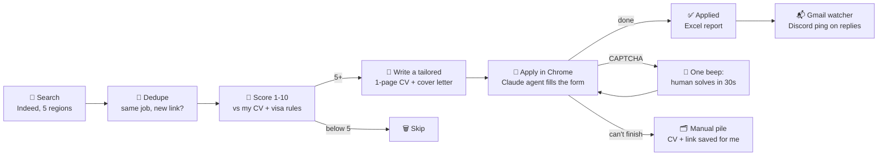

<div align="center">

# 🚀 ApplyPilot UK

### My own AI job-search engine: it finds jobs, writes a tailored CV for each one, and applies.

*A personal project by [@BasilSuhail](https://github.com/BasilSuhail), built and run during my own job search.*


**[🌐 Project page](https://basilsuhail.github.io/applypilot-showcase/)** · **[🔒 Privacy policy](https://basilsuhail.github.io/applypilot-showcase/privacy.html)** · **[⚙️ How it works](docs/how-it-works.md)** · **[🗺️ Roadmap](docs/roadmap.md)**

</div>

---

## ✨ What it is

Applying for graduate jobs by hand means the same few steps hundreds of times: find the ad, check you're eligible, rewrite the CV, write a cover letter, fill in yet another portal. **ApplyPilot UK does those steps for me.** It runs on my Mac (often overnight). An AI agent drives a real Chrome window, and it only taps me on the shoulder when a human is genuinely needed, like a CAPTCHA.

It's a heavily extended, UK-first fork of the open-source [ApplyPilot](https://github.com/Pickle-Pixel/ApplyPilot). The working code and all my personal data stay in a **private** repo; this page shows what it does and how far it has come.

## 📊 Where it stands

<div align="center">

| 🔎 Jobs found | 🧠 Scored by AI | 🎯 Good fits | 📄 Tailored CVs + cover letters | 📨 Applications sent | 🏢 Companies |
|:---:|:---:|:---:|:---:|:---:|:---:|
| **1,203** | **1,203** | **544** | **544** | **413** | **337** |

</div>

- ⚡ **~4 minutes per application**, start to finish, with no human typing.
- 🌍 **5 regions**, applied in priority order: 🇬🇧 UK (349) → 🇦🇪 Middle East (7) → 🇪🇺 Europe (39) → 🇨🇦 Canada (18) → 🇵🇰 Pakistan.
- 📬 **Employer replies are already coming in.** In the first week the email watcher flagged interview invites, online assessments and direct recruiter messages.
- 🗓️ Live since **17 October 2026**. These numbers are a snapshot from 21 October 2026.

## 🔁 How a job flows through it



## 🧩 What I built on top

<table>
<tr><td width="50%" valign="top">

### 🤖 Applying
- A Claude agent drives a real Chrome window through **Playwright MCP** and fills every kind of portal: Workday, SuccessFactors, iCIMS, Taleo, Greenhouse, Lever and more.
- **Sign in with Google** where it's offered. Otherwise it checks Gmail for an existing account, then creates one or resets the password itself.
- Reads verification codes and reset links straight from Gmail (read-only).
- Answers screening questions from a private profile: right to work, salary by region, notice period, equality monitoring with neutral options, essay questions written to the requested length.
- Never uploads a CV longer than one page.

</td><td width="50%" valign="top">

### 🧠 Judging & writing
- Each job is scored 1-10 against my CV. **Hard blockers** knock out roles that need citizenship, security clearance, a licence or a non-English language, or that are reserved for nationals.
- A second model double-checks borderline scores.
- Every good fit gets a **fresh one-page CV and cover letter**, written for that ad and checked by an AI judge.
- Repeat ads are caught: the same job reposted under a different link is applied to once.

</td></tr>
<tr><td valign="top">

### 🙋 Human in the loop
- **CAPTCHA**: one beep and a pop-up, and the agent waits 30 seconds. If I'm asleep, the job is kept and comes up **first** next session, going straight back to that page.
- A CAPTCHA inside a form is handled **last**, after everything else is filled.
- **Assist mode**: the agent works the tricky jobs with me. It says what it's stuck on and I fix it in its window.
- **Manual pile**: anything it can't finish gets a folder with the tailored CV, cover letter and apply link, ready for me to do by hand.

</td><td valign="top">

### 📬 After applying
- **Discord alerts**: a Gmail watcher checks every 10 minutes. 🟢 Interviews and 🟡 assessments ping my phone, ⚪ other real replies arrive quietly, and rejections are never posted. Keyword rules only, so it costs nothing to run.
- **Excel reports** after every round, with what was applied, skipped or failed and why.
- **`jobbot round`**: live lists of what this round found, scored, wrote and applied.
- **Encrypted backup** to my own server (AES-256), with a one-command restore on a new Mac.

</td></tr>
</table>

## 🕹️ Driving it

Everything runs through one command, `jobbot`:

```text
jobbot start      what's waiting → pick a mode (apply / write / search 1, 3 or 7 days / assist)
                  → pick regions (e.g. 1234) → pick the AI per step → go
jobbot round      what this round found, scored, wrote and applied so far
jobbot status     totals, the job it's on now, Discord + Gmail status
jobbot manual     jobs saved for applying by hand (CV, cover letter, link)
jobbot clear      start fresh: move already-tried jobs out of the queue
jobbot discord    on | off | test | check 7
jobbot backup     encrypted full backup to my own server
```

## 🛠️ Stack

| Layer | Tools |
|---|---|
| Discovery | JobSpy (Indeed, 5 regions), custom dedupe, region tagging |
| Scoring & writing | Claude Haiku / Sonnet (also wired: GLM, local Ollama models), one-page PDF builder |
| Applying | Claude Code agent + Playwright MCP + Chrome for Testing, Gmail MCP (read-only) |
| Data | SQLite master database (every job ever found, never wiped), Excel reports |
| Ops | zsh control script, macOS LaunchAgent, `caffeinate`, Discord webhooks, AES-256 backups |

## 🧭 Lessons so far

- **Logins and CAPTCHAs are the real enemy**, not forms. Most of the work went into making the agent sign in smartly and hand over to me at exactly the right moment.
- **Small models need short, explicit rules.** Haiku applies well once the instructions are tight and unambiguous.
- **Never lose a job.** Every failure is either retried, kept for next session, or saved with everything needed to finish it by hand.
- **Measure everything.** Per-round lists and reports made every fix obvious.

## 🗺️ What's next

See the **[roadmap](docs/roadmap.md)**. Coming up: company job boards with no logins (Greenhouse, Lever, Ashby), reply tracking in the reports, and skipping dead ads before applying.

## 🔒 Privacy

Everything runs locally on my Mac. The tool reads only **my own** Gmail, read-only, and never sends, deletes or changes email. Nothing personal is published here. Full details: **[privacy policy](https://basilsuhail.github.io/applypilot-showcase/privacy.html)**.

---

<div align="center">

Built on the open-source <a href="https://github.com/Pickle-Pixel/ApplyPilot">ApplyPilot</a> (AGPL-3.0). The extended code is private.<br/>
Questions or ideas? <a href="https://github.com/BasilSuhail/applypilot-showcase/issues">Open an issue</a>.

</div>
